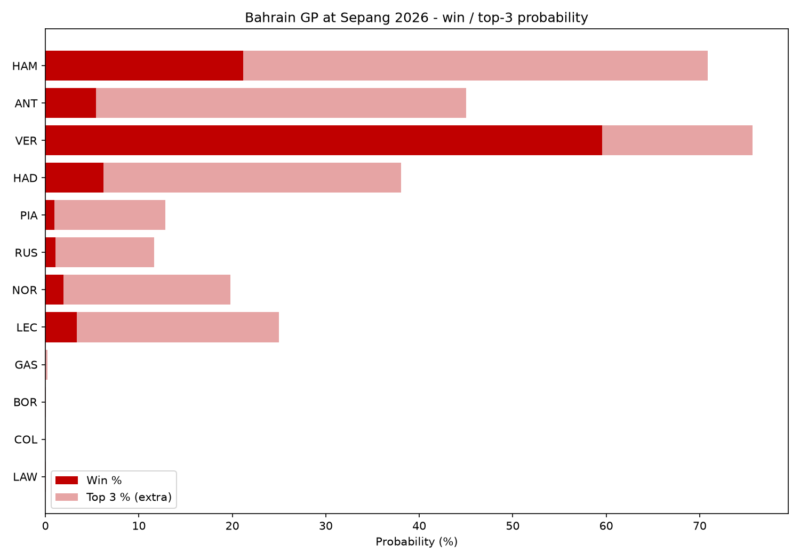

# 2026 Bahrain Grand Prix at Sepang Predictor

A machine learning model that predicts round 16 of the 2026 season, the Bahrain Grand
Prix, held this year at Sepang in Kuala Lumpur. It's built on real F1 timing data
through [FastF1](https://github.com/theOehrly/Fast-F1).

Instead of spitting out one guess at the finishing order, it simulates the whole race
**10,000 times** and counts how often each driver wins, gets a podium, scores points
or doesn't finish at all.



## The hard part about Sepang

F1 hasn't raced here since 2017. FastF1 has no lap data from those races, and only 10
drivers on this grid have ever raced at Sepang, in very different cars. So there is no
track history to learn tyre wear, pit stops, safety cars or crash corners from.

Everything track-specific comes from **this weekend's practice sessions**, Pirelli's
published numbers for the race, and what the 2026 season has shown so far.

## How it works

| Layer | Question it answers | Built from |
|---|---|---|
| Race pace | How quick is each car in clean air? | Qualifying gap, speed trap, season form and engine supplier, through an ensemble of Ridge, Random Forest and XGBoost |
| Retirement risk | How likely is each car to break or crash? | Every retirement of the 2026 season, split up by cause |
| Tyres | How fast do the tyres wear here? | Long runs from this weekend's practice sessions |
| Strategy | Which 1, 2 and 3 stop plans make sense? | Every legal plan, timed with the measured tyre numbers |
| Monte Carlo | What happens across 56 laps? | Lap by lap: track position, traffic, tyre wear, stops, safety cars, retirements |

### The parts I think are interesting

- **Tyre wear measured from practice.** A long run is one set of tyres driven for
  several laps in a row. Each run is compared only against itself, so different fuel
  loads between teams don't matter, only how fast the lap times drift up. Soft and
  medium wear at the same rate here, which Pirelli confirmed after Friday.
- **Strategies are built, not copied.** With no past races to copy, the model builds
  every legal plan (1, 2 or 3 stops, at least two compounds, only the sets a car
  actually has) and times each one. Cars pick plans with a bit of randomness, so the
  whole grid doesn't do the identical race.
- **Safety cars change strategy.** When a safety car comes out, each car decides
  whether to pit, with the same chance real teams did in that situation (measured from
  the safety cars of 2026 and Baku 2021-2025).
  A stop under a safety car costs 65% of a normal one, measured in Shanghai 2026.
- **Retirements are split by cause.** Engine failures are scored per engine supplier,
  because four teams running a Mercedes are all evidence about the same engine.
  Gearboxes go by team, crashes by driver.
- **Grid penalties move you back without making your car slower.** Track position and
  car pace are kept completely separate. A driver who qualifies P3 and takes a five
  place penalty still has the third fastest car, just starting P8.
- **Upgrades.** A team that brings a big upgrade has season form that describes its
  old car, so its predicted pace leans more on this weekend's qualifying.

### Things I tested and left out on purpose

- **Team by team tyre wear.** Practice shows big differences between teams, so it's
  tempting to use them. I tested it on every 2026 race so far: a team's practice tyre
  wear and its race tyre wear had a correlation of **0.04**. Practice differences come
  from fuel loads and run plans, not the car, so every team gets the same wear rate.
- **Track specialists.** Nobody has raced these cars here, so there's nothing to
  measure.

## Does the ML actually beat just guessing?

Everything is tested walk forward. To predict round N it only ever trains on rounds
before N, so nothing from the future leaks back in.

Predicting clean air race pace, rounds 6-15:

| Model | Pace error (MAE, %) | Driver order off by |
|---|---|---|
| Qualifying gap only, no ML | 0.54 | 1.66 places |
| Qualifying gap, rescaled | 0.48 | 1.66 places |
| Ridge | 0.41 | 1.71 places |
| Random Forest | 0.42 | 1.68 places |
| XGBoost | 0.42 | 1.89 places |
| **Ensemble of the three** | **0.40** | 1.78 places |

The honest read: the ensemble is about 26% better at working out *how far apart* the
cars are, but it is **no better than qualifying on its own at ordering drivers**.
Qualifying already knows who's fast. The model earns its place in the simulation
layer instead, with tyres, strategy, retirements and safety cars.

The full simulator was tested the same way on rounds 6-14:

- **Among drivers who finished**, it beats "everyone finishes where they started" by
  about 0.2 places per driver (1.68 vs 1.89 places off), and did better in 5 of the
  9 races.
- **Counting retirements too**, it's a tie (3.12 vs 3.17). Nobody can predict *which*
  car will break down, so retirements swamp everything else.

## Running it

```bash
python -m venv .venv && ./.venv/bin/pip install -r requirements.txt
./.venv/bin/python run_weekend.py
```

Needs Python 3.10+, since FastF1 3.8 is required for 2026 telemetry.

`run_weekend.py` does everything in order: measures the tyres from every practice
session so far, builds the strategies, pulls in qualifying and runs the prediction.
Before qualifying it uses a stand-in grid from practice, clearly marked as such.

Before the final run, check the race weekend inputs at the top of `predict_sepang.py`:
grid penalties, upgrades, and any driver whose qualifying lap was ruined by a crash
or a problem.

### Files

| File | What it does |
|---|---|
| `run_weekend.py` | One command that runs the whole weekend in order |
| `predict_sepang.py` | Main script, ties everything together and produces the prediction |
| `race_sim.py` | The lap by lap race simulator |
| `sepang_tyres.py` | Tyre wear and compound speed from the practice long runs |
| `sepang_strategies.py` | Builds and times every legal race plan |
| `sepang_weekend.py` | Pulls in this weekend's practice and qualifying |
| `pace_data.py` / `pace_model.py` | Builds the race pace dataset and tests the models against baselines |
| `dnf_risk.py` | Retirement probability per car, by cause |
| `safety_car_pits.py` | Measures who pits when a safety car comes out |
| `tyre_backtest.py` | Tests whether practice tyre wear predicts race tyre wear (it doesn't) |
| `backtest_sim.py` | Walk forward testing for the whole simulator |
| `sepang_telemetry.py` | Speed traces of the top four teams' Q3 laps and their Friday long runs |

## What it doesn't do

Putting this here because a model that hides its weak spots isn't worth trusting.

- **No weather.** It predicts a dry race. Sepang often gets afternoon rain, and a wet
  race would be a different race entirely.
- **The hard tyre is borrowed.** Nobody ran a proper long run on the hard in practice,
  so its wear rate is the medium's scaled by what Spa showed with the same compounds.
- **The safety car chance comes from this season**, 8 races out of 15, not from
  Sepang itself.
- **The safety car reaction is simple.** It ignores gaps to rivals and which compounds
  a car has left.
- **The dirty air number is a judgement call.** Traffic costs 0.9s a lap, set by
  comparing against a few real comeback drives, not properly fitted.
- **No multi-car crashes.** Every car's crash risk is rolled on its own, so a pile-up
  that takes out three cars at once can't happen in the simulation.
- **Small samples everywhere.** 22 drivers and 15 races isn't much, which is why
  retirement rates get shrunk towards the grid average instead of taken at face value.

## Data

Timing, telemetry and results all come from FastF1. Retirement causes were summarised
from the Wikipedia race reports, and the number of retirements in each race was
checked against FastF1. Every row records where it came from.

Everything in `data/` is generated by the scripts above, so you can delete it and
rebuild it from scratch. One note if you clone this: `sepang_strategies.pkl` is a
Python pickle, and unpickling runs whatever code the file contains. Mine is safe, but
that's true of any pickle you're told is safe, so regenerate it with
`sepang_strategies.py` rather than loading a copy you didn't make yourself.
